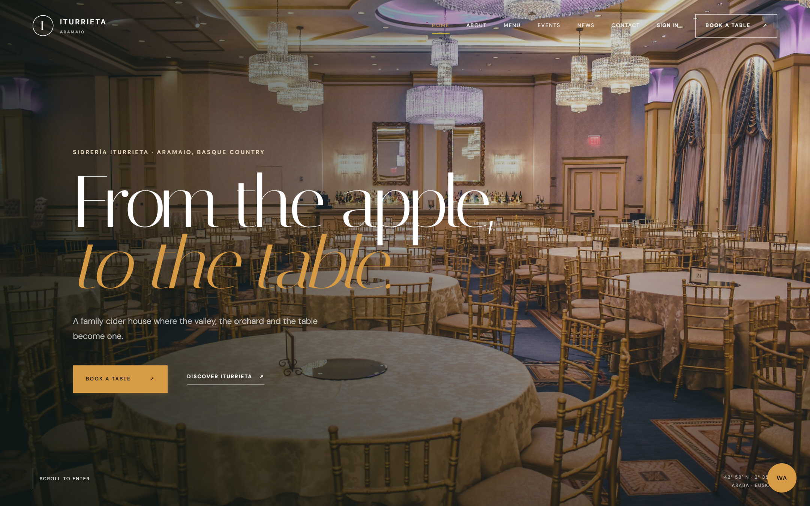
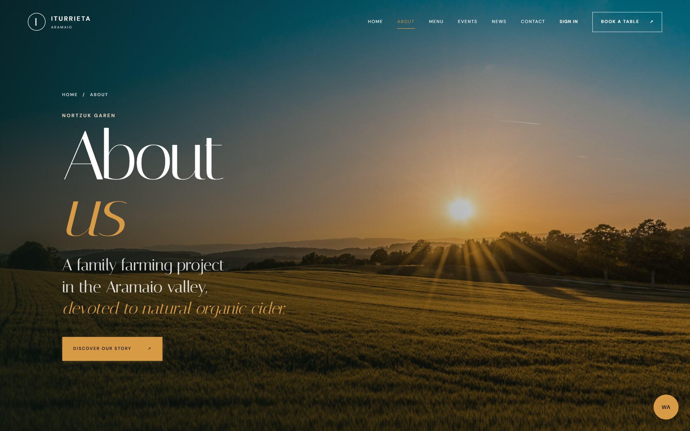
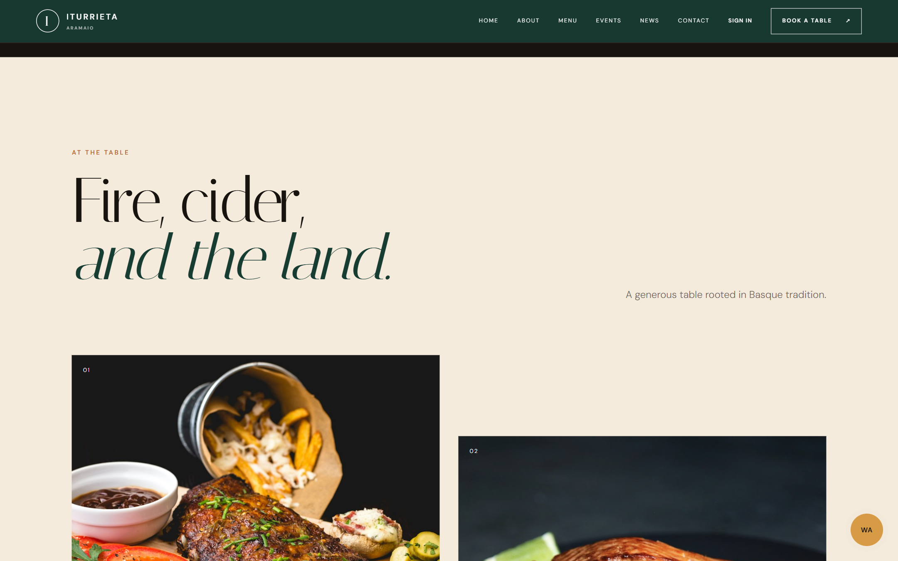
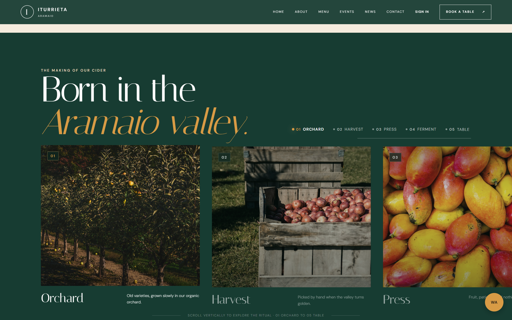
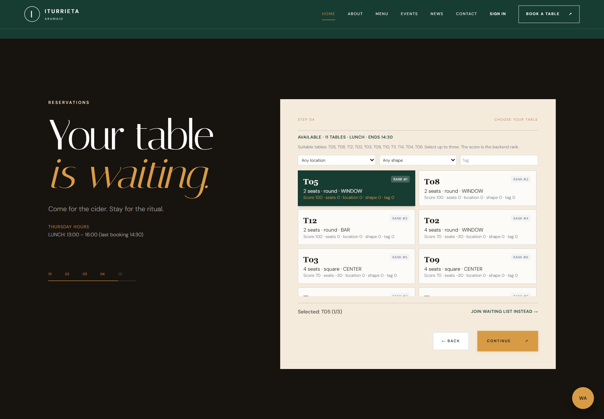
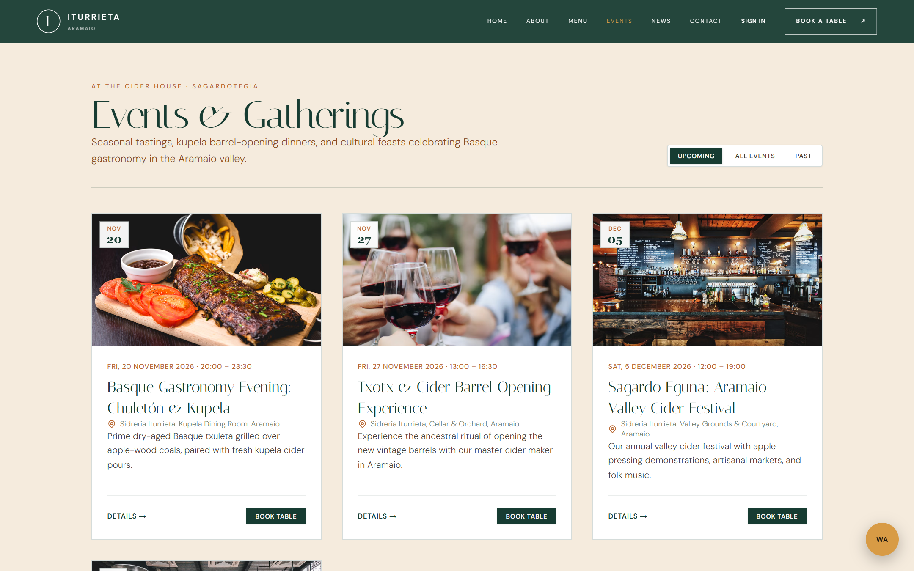
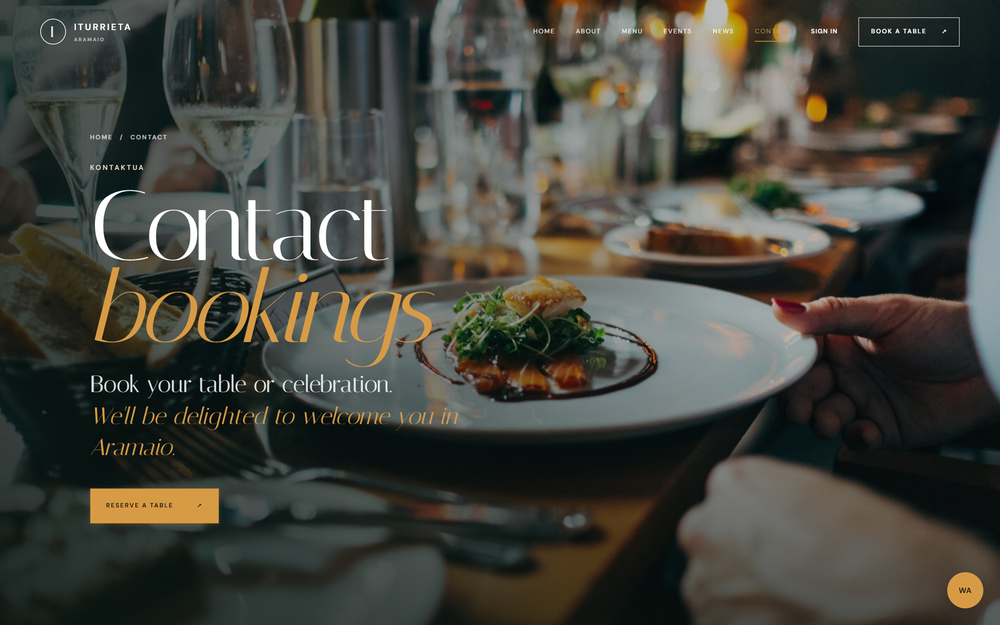
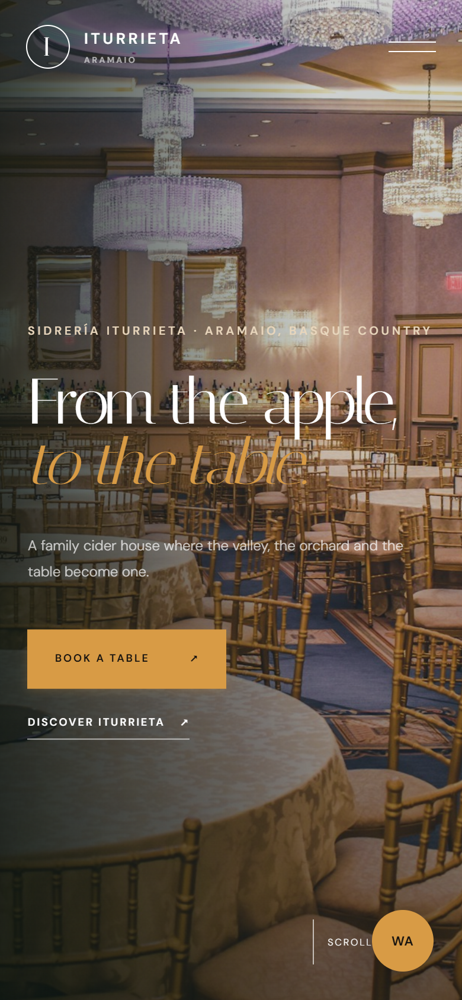
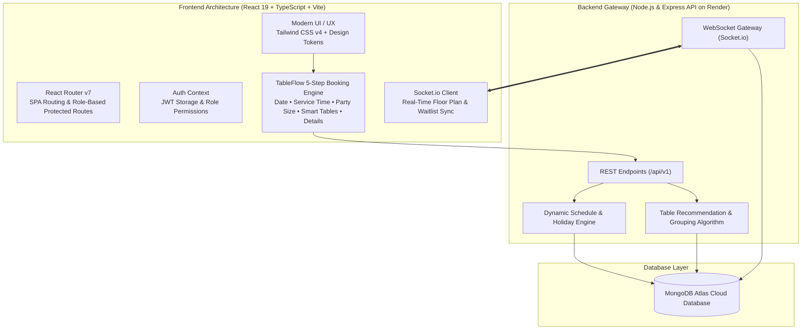

<div align="center">

# 🍷 TableFlow · Sidrería Iturrieta

**Crafting a seamless digital experience and intelligent reservation platform for Sidrería Iturrieta.**

[](https://hackathon-1-hariom-jaiswal-frontend.vercel.app/)
[](https://github.com/hariomjaiswal12/TableFlow)
[](https://www.linkedin.com/in/hariom-jaiswal-82ba74328/)

<br />

[](https://react.dev/)
[](https://www.typescriptlang.org/)
[](https://vitejs.dev/)
[](https://tailwindcss.com/)
[](https://reactrouter.com/)
[](https://socket.io/)
[](https://playwright.dev/)
[](https://vercel.com/)

<p align="center">
  <a href="#-project-overview">Project Overview</a> •
  <a href="#-live-demo">Live Demo</a> •
  <a href="#-application-walkthrough--screenshots">Screenshots</a> •
  <a href="#-core-features">Key Features</a> •
  <a href="#-system-architecture">Architecture</a> •
  <a href="#%EF%B8%8F-technology-stack">Tech Stack</a> •
  <a href="#-uiux-design-system">UI/UX Design</a> •
  <a href="#-getting-started">Getting Started</a> •
  <a href="#-author--contact">Author</a>
</p>

---

</div>

## 📖 Project Overview

**TableFlow** is an enterprise-grade digital dining portal and intelligent table reservation system created specifically for **Sidrería Iturrieta (Iturrieta Sagardotegia)** — an authentic artisanal cider house established in 1998, tucked in the picturesque Aramaio valley of Álava, Basque Country.

Traditional cider houses thrive on centuries-old communal dining customs: long banquet tables, the celebratory ***Txotx*** ritual (where diners gather by massive oak *kupelas* to catch freshly poured natural cider directly from the barrel), and rustic multi-course meals featuring grilled *txuleta* steak, salted cod, and artisanal *talo*. However, running a busy cider house presents intricate operational challenges:

- **Complex Group Seating**: Large Basque parties frequently require combining multiple adjoining tables without exceeding floor fire-safety limits.
- **Dynamic Seasonal Shifts**: The high-volume *Txotx* season (January through May) has fluctuating lunch and dinner service windows that standard reservation tools cannot accommodate.
- **Peak-Hour Table Congestion & No-Shows**: Manual reservations via phone create double-bookings, table vacancies, and uncoordinated waitlists.

**TableFlow bridges rustic Basque tradition with high-performance modern web engineering.** Built with **React 19**, **TypeScript**, and **Tailwind CSS v4**, TableFlow delivers an intuitive 5-step customer booking funnel, an algorithmic table recommendation engine, live availability checks, an interactive floor plan for operational staff, and real-time synchronization via WebSockets.

### 👥 Target Audiences & Use Cases

| User Persona | Key Capabilities & Benefits |
| :--- | :--- |
| **Guests & Diners** | Explore authentic Basque heritage, browse seasonal cider menus, reserve specific tables with instant confirmation codes (`TX-YYYYMMDD-XXXXXX`), join automated waitlists, and manage reservations via an authenticated dashboard. |
| **Floor Hosts & Staff** | Real-time floor plan visualization, instant table state inspection (`AVAILABLE`, `RESERVED`, `OCCUPIED`, `CLEANING`, `BLOCKED`), one-click guest seating, and live dining turnover monitoring. |
| **Restaurant Management** | Configure opening schedules and seasonal closures, adjust group booking rules, manage security deposits, enforce no-show policies, track operational KPIs, and monitor incoming booking channels. |

---

## 🌐 Live Demo

Experience the live application deployed on Vercel's global edge network:

> **Production Application:** [https://hackathon-1-hariom-jaiswal-frontend.vercel.app/](https://hackathon-1-hariom-jaiswal-frontend.vercel.app/)  
> **Source Code:** [https://github.com/hariomjaiswal12/TableFlow](https://github.com/hariomjaiswal12/TableFlow)

---

## 📸 Application Walkthrough & Screenshots

All screenshots below are captured directly from the live production application at **1440×900 desktop** and **390×844 mobile** resolutions.

### 1. Homepage & Hero Section
*Atmospheric introduction highlighting Sidrería Iturrieta's landscape, philosophy, opening times, and direct call to action.*

<div align="center">
  
</div>

<br />

### 2. Basque Heritage & Organic Orchards
*Storytelling component celebrating family cider-making traditions since 1998 across 1,400+ organic apple trees in Aramaio.*

<div align="center">
  
</div>

<br />

### 3. Traditional Basque Cider House Menu
*Showcasing traditional seasonal offerings: Basque Txuleta grilled on open coals, cod with peppers, artisan talo flatbread, and roasted cider apples.*

<div align="center">
  
</div>

<br />

### 4. Artisanal Cider Craft & The Txotx Experience
*The five key phases of craft cider production: Orchard, Harvest, Press, Fermentation in wooden kupelas, and the Table ritual.*

<div align="center">
  
</div>

<br />

### 5. Intelligent TableFlow Booking & Recommendation Engine
*The intelligent table selection step displaying live table availability, backend ranking scores, location filtering (Window, Bar, Center, Private, Outdoor), and group table combination support.*

<div align="center">
  
</div>

<br />

### 6. Events & Cultural Gatherings
*Community-focused calendar presenting guided barrel tastings, Txotx seasonal rituals, and gastronomic gatherings.*

<div align="center">
  
</div>

<br />

### 7. Location, Hours & Contact
*Practical visitor details for Arraga Auzoa 2 in Aramaio, including interactive directions, phone reservations, and WhatsApp direct messaging.*

<div align="center">
  
</div>

<br />

### 8. Mobile-Responsive Experience
*Touch-optimized responsive drawer, fluid typography, and mobile-first booking interface on iOS and Android viewports.*

<div align="center">
  
</div>

---

## ⚡ Core Features

### 1. 🎯 Intelligent 5-Step Table Reservation Funnel
- **Step 01 · Date & Calendar Validation**: Dynamically queries opening days and service rules (`scheduleService`), instantly alerting users if the cider house is closed on selected dates or on holidays.
- **Step 02 · Service Window & Time Slot Selection**: Intelligently renders available seating windows for Lunch (13:00–16:00, last seating 14:30) and Dinner services with real-time capacity thresholds.
- **Step 03 · Party Size & Security Deposit Engine**: Allows seamless guest selection while computing security deposit requirements based on restaurant thresholds (e.g., parties $\ge$ 1 guest with transparent refund conditions).
- **Step 04 · Algorithmic Table Recommendation**: Evaluates table capacities, customer preferences (Window, Bar, Center, Private, Outdoor), and shape (round vs. rectangular). Recommends optimal seating using backend ranking scores and supports combining up to 3 tables for large Basque groups.
- **Step 05 · Guest Information & Instant Confirmation**: Captures guest details, dietary notes, and generates an immutable reservation reference code (e.g., `TX-20261105-AB12CD`).

### 2. ⏳ Automated Waitlist Integration
- When table availability reaches full capacity, the funnel automatically prompts diners to join the **Digital Waitlist**.
- Automatically captures preferred service windows and party sizes, notifying guests immediately when a table opens up.

### 3. 🗺️ Live Operations Floor Plan & Staff Portal
- Designed for floor hosts and waiting staff with real-time **Socket.io** event streaming.
- Visual floor view displaying dynamic color-coded table states:
  - 🟢 **Available** · Ready for seating
  - 🔵 **Reserved** · Booked for an upcoming service window
  - 🟠 **Occupied** · Guests currently dining
  - 🟡 **Cleaning** · Table turnaround in progress
  - 🔴 **Blocked** · Maintenance or host hold
- Staff can mark guest arrival, complete dining cycles, or flag no-shows in a single click.

### 4. 📊 Executive Admin Dashboard & Analytics
- Complete operational analytics suite with visual KPIs:
  - Total confirmed bookings, total covers, and calculated occupancy rate.
  - Hourly dining distribution charts and service window utilization metrics.
  - Blacklist management restricting repeat no-show offenders.
  - Integration monitors for incoming phone and messaging webhooks.

### 5. 🔐 Robust Authentication & Role-Based Access Control (RBAC)
- Clean modal authentication supporting customer registration, secure login, and session persistence via JWT tokens.
- Strict route protection with tiered permission levels:
  - `CUSTOMER` → Access to personal reservation dashboard and notification inbox.
  - `STAFF` → Operational floor plan, waitlist controls, and table state toggling.
  - `ADMIN` → System analytics, schedule configuration, table layout editor, and blacklist management.

---

## 🏗️ System Architecture



---

## 🛠️ Technology Stack

| Layer | Technologies Used | Purpose |
| :--- | :--- | :--- |
| **Core Framework** | **React 19** (`^19.0.0`) | Cutting-edge UI rendering, concurrent features, and modern component lifecycle hooks. |
| **Language** | **TypeScript 5.7** (`^5.7.0`) | End-to-end type safety, strict interface contracts for API payloads, and predictable code. |
| **Build & Tooling** | **Vite 8** (`^8.0.5`) | Ultra-fast Hot Module Replacement (HMR) and optimized rollup production bundles. |
| **Styling & Design** | **Tailwind CSS v4** (`^4.0.0`) | Utility-first styling with `@tailwindcss/vite` integration, CSS variables, and design tokens. |
| **Client Routing** | **React Router DOM v7** (`^7.18.4`) | Declarative client-side routing, protected routes, and scroll-to-hash management. |
| **Real-Time Layer** | **Socket.io Client** (`^4.8.4`) | Low-latency bi-directional WebSocket connection for live floor plan and table updates. |
| **Testing & Automation** | **Playwright** (`^1.64.1`) | Automated browser testing, visual regression verification, and high-fidelity screen captures. |
| **Hosting & CI/CD** | **Vercel Edge Network** | Instant edge deployments, global CDN caching, SSL certificates, and client-side rewrites. |
| **Backend Integration** | **Node.js / Express / MongoDB** | RESTful API and WebSocket gateway hosted on Render. |

---

## 🎨 UI/UX Design System

The visual identity of TableFlow honors the earthy, welcoming atmosphere of an authentic Basque *sagardotegi*:

```css
:root {
  --forest:  #173c32; /* Deep Pyrenean forest green */
  --dark:    #17130f; /* Basque slate and aged oak */
  --brown:   #8b4e24; /* Terracotta & roasted chestnuts */
  --copper:  #b96832; /* Warm cider press copper */
  --cream:   #f5ebdd; /* Artisan linen background */
  --ivory:   #faf7f2; /* Clean card containers */
  --beige:   #e8d6bc; /* Weathered parchment accents */
  --sage:    #71856e; /* Wild orchard apple leaf */
  --gold:    #d89b45; /* Txotx golden natural cider */
  
  --serif:   "Italiana", Georgia, serif;
  --sans:    "DM Sans", -apple-system, sans-serif;
  --ease:    cubic-bezier(0.22, 1, 0.36, 1);
}
```

### Key Design Pillars
- **Editorial Typography Pairing**: Distinctive serif titles (`Italiana`) balance artisanal Basque craftsmanship with contemporary sans-serif body copy (`DM Sans`) for maximum legibility.
- **Progressive Disclosure**: The booking funnel breaks a complex table selection process into five lightweight steps, preventing cognitive overload.
- **Sensory Micro-Interactions**: Custom `useReveal` hook coordinates subtle scroll-triggered entry transitions without impacting rendering performance.
- **Accessibility & Contrast**: High-contrast text tokens, semantic HTML elements, ARIA dialog roles, and full keyboard navigation (including `Esc` dismissals).

---

## 📂 Project Structure

```text
TableFlow/
├── docs/
│   └── screenshots/              # Real production application screenshots
│       ├── 01-homepage.png
│       ├── 02-about.png
│       ├── 03-menu.png
│       ├── 04-experiences.png
│       ├── 05-reservation.png
│       ├── 06-events.png
│       ├── 07-contact.png
│       └── 08-mobile-responsive.png
│
├── public/                       # Static assets, favicon, brand photography
│   └── images/                   # High-res photography (orchard, kupela, dishes)
├── src/
│   ├── components/               # Reusable UI component modules
│   │   ├── About/                # Heritage introduction section
│   │   ├── Auth/                 # Login, register, and protected route wrappers
│   │   ├── BookingSection/       # 5-step interactive table booking engine
│   │   ├── Content/              # Events and news editorial blocks
│   │   ├── Hero/                 # Cinematic hero with seasonal hours
│   │   ├── MenuSection/          # Basque culinary specialties grid
│   │   ├── Navbar/               # Dynamic navigation header & mobile drawer
│   │   └── StorySection/         # 5-stage craft cider making journey
│   ├── context/                  # React Context (AuthContext & user sessions)
│   ├── data/                     # Static content, dish definitions, navigation links
│   ├── hooks/                    # Custom React hooks (useReveal, useAuth)
│   ├── lib/                      # Booking validation and API error formatters
│   ├── pages/                    # Top-level view routes
│   │   ├── About/                # Complete heritage and orchard history page
│   │   ├── AdminDashboard/       # Manager KPI panels, jobs, and blacklist
│   │   ├── Contact/              # Directions, maps, and direct contact
│   │   ├── Dashboard/            # Customer reservation management page
│   │   ├── Events/               # Cultural events listing & details
│   │   ├── Home/                 # Landing page orchestrator
│   │   ├── News/                 # Announcements and seasonal harvest updates
│   │   └── Operations/           # Live staff floor plan & table orchestrator
│   ├── services/                 # API client & backend service integration
│   │   ├── apiClient.ts          # Axios/fetch abstraction with auth headers
│   │   ├── bookingService.ts     # Create, reschedule, and cancel reservations
│   │   ├── realtime.ts           # Socket.io floor state subscriptions
│   │   └── tableService.ts       # Table availability and recommendations
│   ├── styles/                   # Global tokens, typography, and Tailwind CSS v4
│   ├── types/                    # Strict TypeScript interfaces for API schemas
│   ├── App.tsx                   # Root component & React Router configuration
│   └── main.tsx                  # Application entry point
│
├── .env.example                  # Environment variables template
├── .env.production               # Production environment configuration
├── index.html                    # HTML entry template with web fonts
├── package.json                  # Project dependencies & scripts
├── tsconfig.json                 # TypeScript compiler settings
├── vercel.json                   # Edge deployment SPA rewrite rules
├── vite.config.ts                # Vite configuration with aliases & plugins
└── README.md                     # Project documentation
```

---

## 🚀 Getting Started

Follow the instructions below to set up and run TableFlow locally.

### Prerequisites
- **Node.js**: `v18.0.0` or higher (recommended: `v20+` or `v24+`)
- **npm**: `v9.0.0` or higher

### 1. Clone the Repository
```bash
git clone https://github.com/hariomjaiswal12/TableFlow.git
cd TableFlow
```

### 2. Install Dependencies
```bash
npm install
```

### 3. Configure Environment Variables
Create a `.env` file in the root directory (you can copy `.env.example`):

```bash
cp .env.example .env
```

Ensure your `.env` contains the backend API target:
```env
VITE_API_BASE_URL=https://hackathon-1-hariom-jaiswal-backend.onrender.com/api/v1
VITE_API_URL=https://hackathon-1-hariom-jaiswal-backend.onrender.com/api/v1
```

### 4. Run the Development Server
```bash
npm run dev
```
Open your browser and navigate to `http://localhost:5173/` (or `http://127.0.0.1:5173/`).

### 5. Build for Production
```bash
npm run build
```
This runs TypeScript validation (`tsc --noEmit`) and compiles optimized static assets into the `dist/` directory.

### 6. Preview Production Build
```bash
npm run preview
```

---

## ☁️ Deployment

The frontend application is continuously deployed to **Vercel** with global edge CDN routing.

To support client-side routing on single-page applications without 404s on page refresh, the repository includes `vercel.json`:

```json
{
  "rewrites": [
    {
      "source": "/(.*)",
      "destination": "/index.html"
    }
  ]
}
```

Every push to the production branch automatically triggers Vercel's build pipeline (`tsc --noEmit && vite build`), followed by immediate global edge distribution.

---

## 🔮 Future Roadmap

- [ ] **3D Interactive Cellar Tour**: WebGL / Three.js interactive tour through the historical *kupela* barrel cellar.
- [ ] **Multi-Lingual Localization (i18n)**: Native language switching between Euskera (*Basque*), Castellano (*Spanish*), English, and French.
- [ ] **One-Tap Digital Wallets**: Native Apple Pay and Google Pay integration for swift deposit checkout.
- [ ] **Automated SMS & WhatsApp Alerts**: Direct guest messaging when waitlist tables open up.

---

## 👨‍💻 Author & Contact

**Hariom Jaiswal**  
*Frontend Developer & UI/UX Specialist*

- **GitHub:** [@hariomjaiswal12](https://github.com/hariomjaiswal12)
- **LinkedIn:** [Hariom Jaiswal](https://www.linkedin.com/in/hariom-jaiswal-82ba74328/)
- **Live Project:** [TableFlow Application](https://hackathon-1-hariom-jaiswal-frontend.vercel.app/)

---

<div align="center">
  <sub>Crafted with passion for authentic Basque gastronomy and modern web engineering.</sub>
</div>

